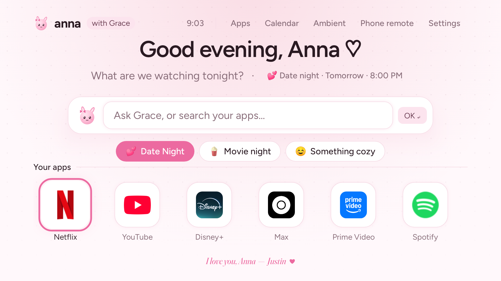
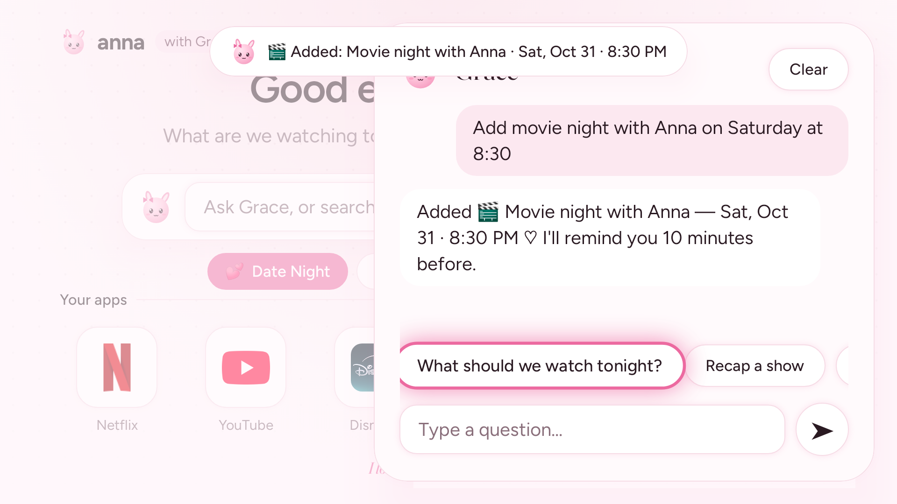
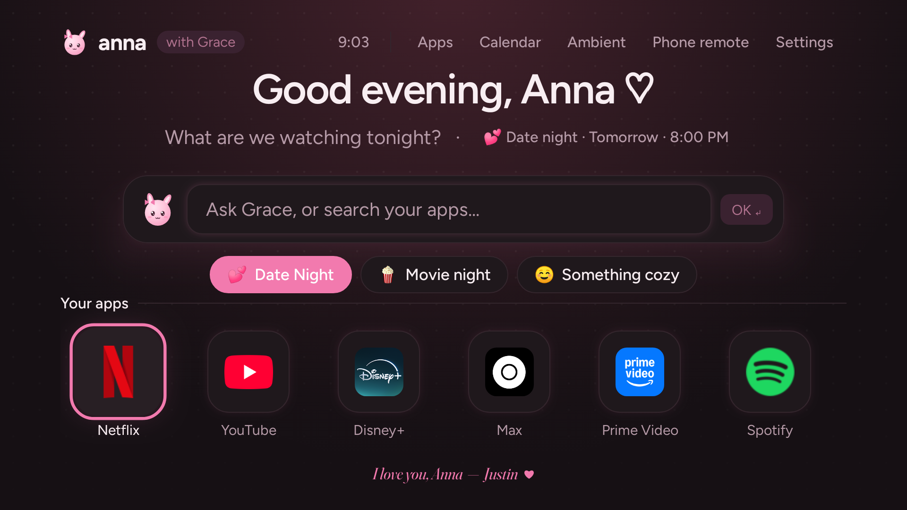
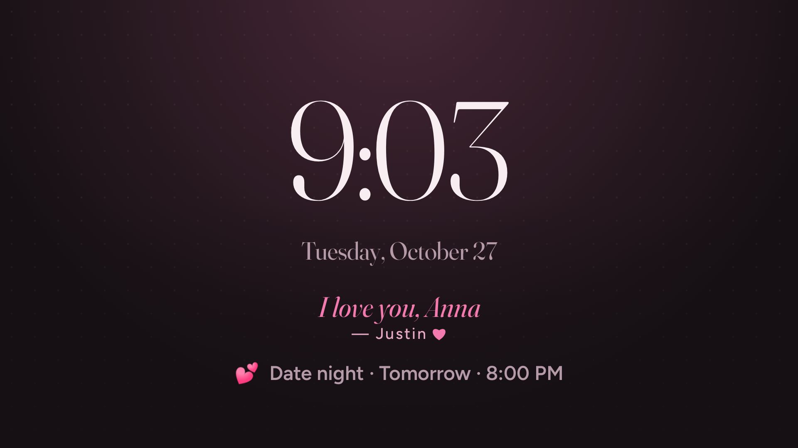

# Glass TV

A custom home screen for a TCL Google TV: cozy, pink, clean SaaS-style design, a local-AI assistant (Ollama on your PC), and a phone remote that runs in the phone's browser. Installs straight on the TV and runs with no PC attached. Only the assistant needs the PC.

Kotlin · Jetpack Compose for TV · single module · 6 runtime dependencies (Compose, TV Material, DataStore, coroutines, NanoHTTPD, ZXing).

## Quick start

```sh
# 1. On the TV: enable Developer options (Settings → System → About → tap the build number 7×),
#    then turn on network ADB / USB debugging. Note the TV's IP (Settings → Network).
# 2. From this repo (needs JDK 17+ and Android SDK; adb on PATH):
scripts/deploy.sh 192.168.1.42          # builds release, installs over Wi-Fi, launches
```

Then:
1. Make Home open Glass TV: [docs/home-button.md](docs/home-button.md). Short version: **Settings → System → Accessibility → Glass TV Home button → On**.
2. Set up the assistant on your PC: [docs/ai-setup.md](docs/ai-setup.md).
3. Scan the QR code to pair your phone: [docs/phone-remote.md](docs/phone-remote.md).

Every system-level change and its exact undo: **[docs/recovery.md](docs/recovery.md)**.

## Screens

Rendered from the real launcher code at 1920×1080. App art here is stand-in initials (no real apps exist in the test environment); on the TV every tile and card shows the app's own official banner or icon, pulled from the installed app.

| Home | Assistant |
|---|---|
|  |  |
| **Home (dark)** | **Ambient** |
|  |  |

Regenerate: `./gradlew :app:testDebugUnitTest -PtvScreens --tests '*TvScreensTest*'` (writes `docs/screens/`).

## Features (v1)

| | |
|---|---|
| **Home** | Cozy, pink, clean SaaS (Apple × Vercel × Perplexity): a quiet top bar (anna · with Grace, time, Ambient / Phone remote / Settings); a centred “Good evening, Anna ♡” hero with one big **Ask Grace** box and three suggestion chips; one calm row of app cards with real icons; Justin's note at the foot. Blush-white with a faint dot grid and a soft pink glow (dark: deep plum). |
| **Date Night 💕** | One press picks a random movie or show for Justin & Anna: 30% Justin's taste (action, comedy), 30% Anna's (romance, girly), 40% meet-in-the-middle (action rom-coms, rom-coms). Slot-machine spin, no recent repeats, works offline; *Ask Grace* for details and where to stream. Also on the phone remote. |
| **Calendar** | Grace adds events from plain speech on the TV, no PC needed (“add dinner with Mom Friday at 7pm”, “remind me to call the vet tomorrow at noon”) and answers “what's on our calendar this week?”. Month view + agenda (OK twice to delete), *Up next* on home and in ambient, reminders 10 min before (toast on Glass TV, notification over other apps). Stored on the TV. Phone remote: Calendar button, *Add an event*, *Our week*. |
| **Apps hub** | Built-in apps: Calendar, Date Night, Lists (groceries/to-do/chores), Timers, Countdowns, Watchlist (his & hers ♥ ratings), Love Notes (sent from the phone), Memory (“Grace, remember…”), Sleep Timer, Fireplace, Would You Rather, Guest Wi-Fi QR. Grace handles them by voice/text on the TV. More marked *Soon*. |
| **Boot** | With the Home-button service on, Glass TV opens right after the TV powers on. |
| **Animations** | Gentle fade-up on each return home, Grace blinks, springy pink-ring focus on cards. All off with *Reduce motion*. |
| **Apps** | All leanback apps, then phone-only launcher apps. Live updates on install/uninstall. Default favorites are whichever of Netflix, YouTube, Disney+, Max, Prime Video, Spotify, Plex and Twitch are installed. **Long-press OK** on a tile to pin or unpin it. Reorder in Settings. |
| **Focus** | Focused tile scales 1.08× with a solid rose ring and a pink glow. |

| **Assistant** | Glass sheet slides in from the right. Streams from Ollama. Quick-prompt chips. "open Netflix" style commands run locally. Plain-language error card with the fix when the PC is unreachable. |
| **Phone remote** | Pink-glass web remote with app **shortcuts** (real icons) and quick actions (Assistant, Ambient, Settings), plus D-pad, OK, back, home, media keys, volume, touchpad, keyboard and dictation. WebSocket with auto-reconnect. 4-digit pairing, remembered phones, revoke in Settings. |
| **Ambient** | After 3 idle minutes: a big clock over the drifting orbs. Any button wakes it. |
| **Settings** | Theme (light/dark/auto), reduce motion, weather location and units, Ollama host and model with a connection test, home-button control, favorites, paired phones, QR, and shortcuts to Android TV settings and inputs. Persisted with DataStore. |

## Project layout

```
app/src/main/java/dev/glasstv/launcher/
  GlassApp.kt            app singletons + phone-remote command routing
  MainActivity.kt        HOME/LEANBACK activity, key handling, ambient wake
  data/                  DataStore settings, installed-app repo, Open-Meteo weather
  ai/                    Ollama streaming client, local commands, conversation state
  remote/                NanoHTTPD + WebSocket server, pairing, foreground service
  a11y/                  Home-button AccessibilityService, remote actions in other apps
  ui/theme, ui/components, ui/screens
app/src/main/assets/remote/index.html   the phone remote (single file, no build step)
scripts/deploy.sh                       build + install + launch
docs/                                   setup, recovery, limitations, performance
```

## Development

```sh
./gradlew testDebugUnitTest lintDebug assembleRelease
```

Unit tests cover local command parsing, pairing (expiry, lockout, single use), Ollama URL handling and paired-phone persistence.

**Not verified on hardware yet.** This was built and tested off-device: it compiles, lint passes, and unit tests pass, but it hasn't run on the TCL. Check these on the TV first, using [docs/performance.md](docs/performance.md) for the numbers:
- 60 fps and cold start
- Which home-button path your firmware takes
- CEC volume behaviour

**Upgrading:** dependencies are pinned to the newest versions that support AGP 8.13. Newer Compose releases require AGP 9.1+ and Gradle 9. That's a separate migration.

## Licenses

Fraunces and Figtree are bundled as static TTFs from Google Fonts. Both are licensed under the [SIL Open Font License 1.1](https://openfontlicense.org).

## Later (not v1)

- Ring doorbell pop-ups through Home Assistant and Scrypted
- Live tiles with now-playing
